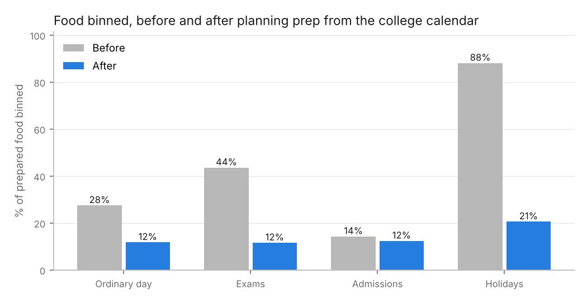
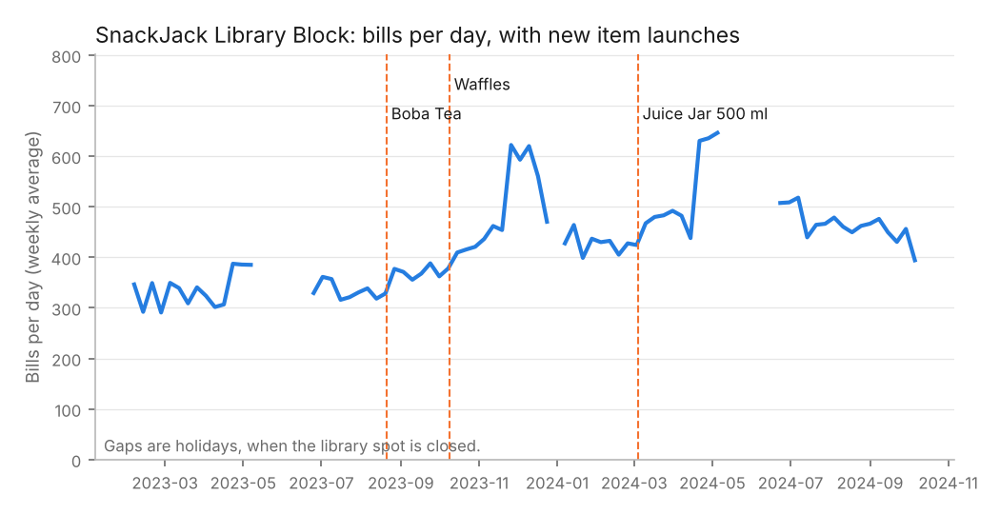

# Snackjack: five campus food spots, looked at properly

From February 2023 to October 2024 I ran operations at Snackjack Foods in Coimbatore. We sold food inside college
campuses under two brands, FoodJack (meals) and SnackJack (snacks and drinks), and grew from one shop to five spots.

This project goes back over the problems I dealt with there and does it the way a business analyst would: the
problems written down as questions, the daily routine mapped, the records analysed in SQL, each change checked
before and after, and the requirements for a proper tool written up.

## Why I built this

At Snackjack I did most of this by common sense. I noticed students coming in groups, saw what was left in the bin,
checked the exam timetable before ordering stock, and changed things. I did not know business analysts had names
and formats for it. This is me doing the same work the formal way.

## About the data

**The problems and what I did about them are real. The data is rebuilt.** I no longer have the original records,
so `src/generate_data.py` rebuilds them with the same shape as what we kept every day: item-wise sales from each
spot's billing machine, FoodJack food weighed before serving and again before binning, SnackJack leftovers counted
in cups and pieces, and the college calendar. The spots and the menu are real; prices, quantities, the months of
each change and the size of each effect are illustrative.



## Read it in this order

| | Document | What it covers |
|---|---|---|
| 1 | [Context and problems](docs/01_context_and_problems.md) | The spots, why campus trade is different, six problems as questions |
| 2 | [How a day runs](docs/02_how_a_day_runs.md) | The daily routine as a process map, and what we recorded |
| 3 | [Findings](reports/findings.md) | The analysis, every number generated from the SQL results |
| 4 | [What I changed](docs/03_what_I_changed.md) | Problem, finding, change and how it was checked |
| 5 | [Requirements](docs/04_requirements.md) | Business requirements and user stories for a proper tool |
| 6 | [Dashboard requirements](docs/05_dashboard_requirements.md) | The weekly spot report for Power BI |

## What the analysis shows

- **A star dish per spot.** Chicken kothu parotta leads FoodJack at the arts college; boba tea leads every SnackJack.
- **New items bring students in.** Bills per day rose after boba tea, waffles and 500 ml juice jars, each backed by
  Canva posters and the student WhatsApp community.
- **Students move in groups.** Quiet spells came in runs of several days, not single bad days.
- **Upselling in their own slang** raised items per bill at both brands.
- **The calendar drives waste.** Prepping every day like an ordinary day binned the most food on exam days and
  holidays. Planning from the calendar cut that sharply.
- **Veg against chicken.** Veg dishes were binned far out of proportion to how much students ate them, so the
  FoodJack menu was rebuilt around chicken.
- **Some food does not travel.** Dishes sent from the hub kitchen to the engineering college that did not hold up
  were binned about twice as often, so that menu was redesigned.



## Running it

```bash
pip install -r requirements-dev.txt
python src/generate_data.py   # rebuilds data/*.csv (already committed, same every run)
python src/analyse.py         # runs sql/*.sql, writes outputs/, reports/findings.md and the charts
python -m pytest              # 15 tests
```

| Folder | Contents |
|---|---|
| `data/` | Spots, menu, calendar, changes, billing machine totals, waste logs |
| `sql/` | The queries behind each finding (SQLite) |
| `src/` | Data rebuild, analysis, quiet-spell detection |
| `outputs/` | Query results as CSV, ready for Power BI or Excel |
| `reports/` | Findings and charts |
| `docs/` | The business analysis documents |

The tests check that SQL totals match a separate pandas calculation, that the committed data matches the generator,
and that each finding holds.

## Limitations

- Before and after comparisons overlap with other changes and with the calendar. Where that matters, the findings
  say so and use a cleaner measure.
- Only 80 ordinary weekdays come before the WhatsApp community started, so the quiet-spell comparison rests on a
  small sample.
- Stock, vendor payments, staff and salaries were recorded at Snackjack but are not rebuilt here.

## Next

- Build the weekly spot report in Power BI from `docs/05_dashboard_requirements.md`.
- Put the user stories on a Jira board.
