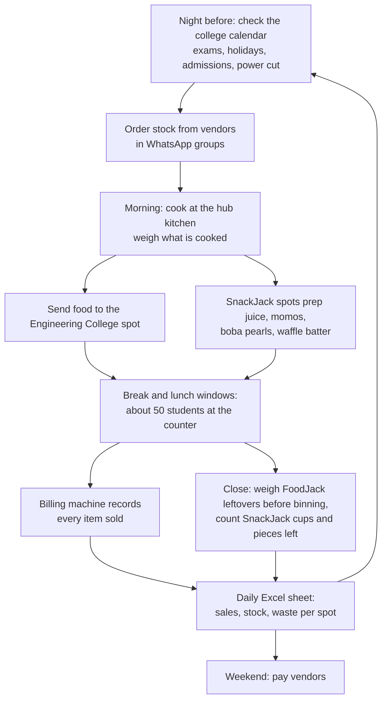

# 2. How a day runs, and what we recorded

The routine once the changes in [What I changed](03_what_I_changed.md) were in place. Before them, the first step
(checking the calendar) did not exist and prep was the same every open day.

## What we recorded every day

| Record | Where it came from | File in this project |
|---|---|---|
| Items sold per spot | Standalone billing machine, item-wise total at close | `data/billing_item_sales.csv` |
| Number of bills per spot | Billing machine | `data/billing_daily.csv` |
| FoodJack: kg cooked and kg binned | Weighed before serving and again before binning | `data/foodjack_waste_log.csv` |
| SnackJack: portions prepped and thrown away | Counted in cups and pieces | `data/snackjack_waste_log.csv` |
| College calendar | Exam timetables, holiday lists, admissions dates | `data/calendar.csv` |
| Stock coming in, vendor bills and payments | Vendor bills, weekend payments | Not rebuilt here |
| Staff and salaries | Rosters and pay | Not rebuilt here |

SnackJack waste was easy to count exactly, because juice is measured in cups and snacks in pieces. FoodJack waste had
to be weighed, and the cost of what was binned was worked out from the ingredients, so it was approximate.

## Pain points in the routine, before the changes

| # | Pain point |
|---|---|
| D1 | Prep was the same every open day, whatever the calendar said |
| D2 | Waste was written down but not compared by dish, spot or kind of day |
| D3 | Food for the Engineering College spent time on the road before it was served |
| D4 | In a 90 minute window there is no time to talk customers into anything unless it is quick and in their language |
