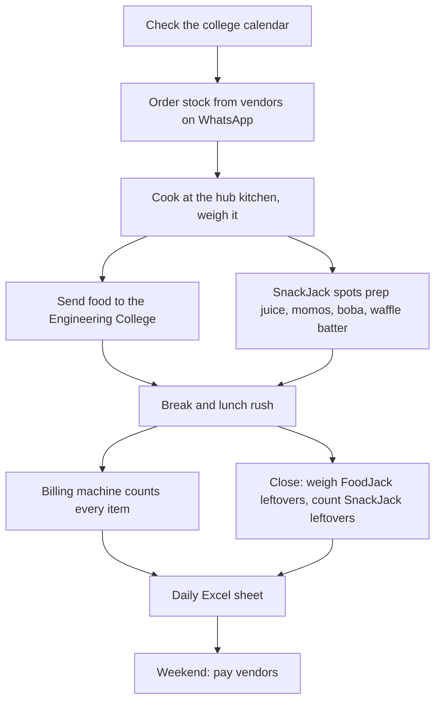
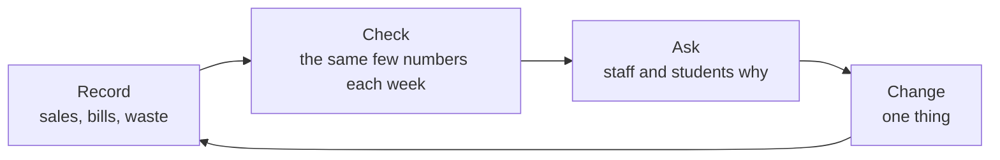

# How we ran it

## The spots

| Spot | Brand | Sells |
|---|---|---|
| Arts College | FoodJack | Meals. Also the hub kitchen |
| Engineering College | FoodJack | Meals, cooked at the hub and sent over |
| Arts College Library Block | SnackJack | Snacks, juices, shakes, tea and coffee |
| Boys Hostel | SnackJack | Same |
| Girls Hostel | SnackJack | Same |

Business inside a campus is its own thing. Students get a 30 minute break and a 45 minute lunch, so most of the day's
trade happens in about an hour and a half, with around 50 students at the counter. Exams, holidays, admissions and
power cuts change who turns up. And students choose where to eat with their friends.

## A day

## The loop

The numbers checked every week:

| Number | Tells you |
|---|---|
| Bills per day, per spot | Are students coming? |
| Items per bill | Are they buying more than one thing? |
| % of food binned, per spot and dish | Are we cooking the right amount of the right things? |

## What we recorded

| Record | From | File here |
|---|---|---|
| Items sold per spot per day | Billing machine | `data/billing_item_sales.csv` |
| Bills per spot per day | Billing machine | `data/billing_daily.csv` |
| FoodJack kg cooked and kg binned | Weighed | `data/foodjack_waste_log.csv` |
| SnackJack portions prepped and thrown away | Counted in cups and pieces | `data/snackjack_waste_log.csv` |
| Exams, holidays, admissions, power cuts | College notices | `data/calendar.csv` |
| Stock, vendor bills, staff, salaries | Bills and rosters | Not rebuilt here |
