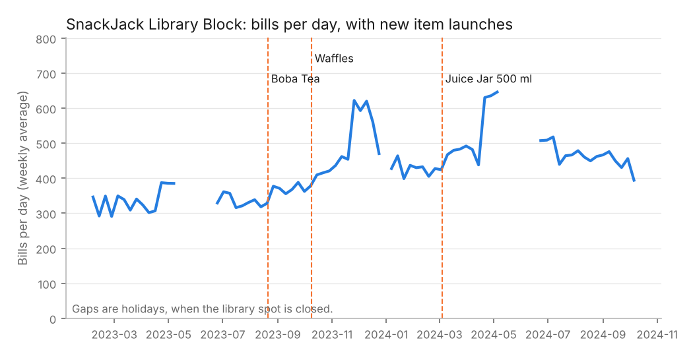
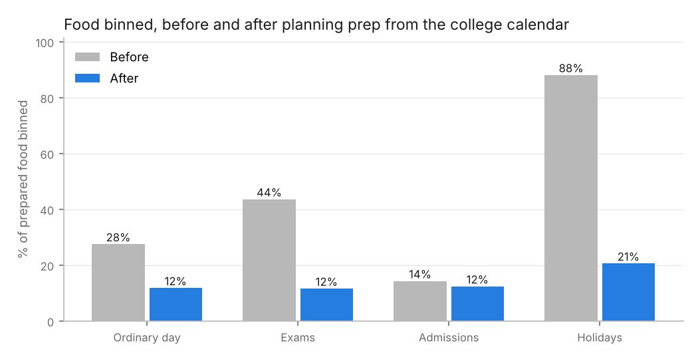

# Findings

Generated by `src/analyse.py`. Every number below comes from the query results.
The records are rebuilt sample data (see the README): the problems and what I changed are real,
the sizes of the effects are illustrative.

## The spots

| Spot | Opened | Sales (₹) | Bills | Average bill (₹) | Waste % of sales |
|---|---|---|---|---|---|
| SnackJack, Boys Hostel | 2023-06-15 | 15,873,920 | 174,739 | 90.8 | 3.7 |
| FoodJack, Arts College | 2023-02-01 | 15,271,790 | 97,702 | 156.3 | 7.2 |
| SnackJack, Arts Library Block | 2023-02-01 | 14,667,640 | 184,150 | 79.7 | 3.5 |
| SnackJack, Girls Hostel | 2024-01-08 | 11,464,645 | 113,054 | 101.4 | 3.4 |
| FoodJack, Engineering College | 2023-08-01 | 6,894,960 | 42,350 | 162.8 | 5.4 |

## 1. A star dish for each spot

`sql/02_star_dish.sql`, last six months of sales:

| Spot | Rank | Item | Share of spot's sales % |
|---|---|---|---|
| FoodJack, Arts College | 1 | Chicken Kothu Parotta | 24.2 |
| FoodJack, Arts College | 2 | Chicken Biryani | 18.2 |
| FoodJack, Arts College | 3 | Chicken Fried Rice | 13.3 |
| FoodJack, Engineering College | 1 | Chicken Biryani | 36.0 |
| FoodJack, Engineering College | 2 | Chicken Fried Rice | 29.2 |
| FoodJack, Engineering College | 3 | Plain Biryani | 13.5 |
| SnackJack, Boys Hostel | 1 | Boba Tea | 16.8 |
| SnackJack, Boys Hostel | 2 | Chicken Momos | 11.1 |
| SnackJack, Boys Hostel | 3 | Cheese Fries | 10.6 |
| SnackJack, Girls Hostel | 1 | Boba Tea | 23.2 |
| SnackJack, Girls Hostel | 2 | Waffles | 10.5 |
| SnackJack, Girls Hostel | 3 | Milkshake | 9.9 |
| SnackJack, Arts Library Block | 1 | Boba Tea | 20.0 |
| SnackJack, Arts Library Block | 2 | Waffles | 10.1 |
| SnackJack, Arts Library Block | 3 | Juice Jar 500 ml | 8.5 |

FoodJack Arts College is led by **Chicken Kothu Parotta**. Every SnackJack spot is led by **Boba Tea**. At the
Engineering College the leader is **Chicken Biryani**, because Kothu Parotta does not survive the trip from the hub
kitchen (see section 7).

## 2. New items brought students to the counter

`sql/03_new_items.sql`, SnackJack spots open for the full 8 weeks around each launch:

| Launch | Bills per day, 4 weeks before | Bills per day, 4 weeks after | New item's share of SnackJack sales after % |
|---|---|---|---|
| Boba Tea | 321.0 | 364.0 | 19.9 |
| Waffles | 373.0 | 417.0 | 10.0 |
| Juice Jar 500 ml | 421.0 | 482.0 | 9.6 |

Each launch was backed by Canva posters and posts in the student WhatsApp community. Bills per day rose after each one.
Part of each rise comes from other things: the juice jars launched as summer started, when cold drinks sell more
anyway, and the spots were still growing. So the new item's own share of sales is the cleaner measure.

## 3. Students move in groups

`switching_streaks` in `src/analyse.py` marks a drop when a spot's bills on an ordinary weekday fall below 85% of its
recent normal, and measures how many days each drop lasts.

| Period | Drop days per 100 days | Drops | Average length (days) | Drops lasting 2+ days % |
|---|---|---|---|---|
| before | 13.8 | 5 | 2.2 | 80.0 |
| after | 1.2 | 10 | 1.1 | 10.0 |

Before the WhatsApp community and the posters, drops came **13.8 days in every 100**
(only 80 ordinary weekdays, so a small sample),
and 80% of them lasted two days or more. Random bad days rarely
come in runs; a group of friends deciding to eat somewhere else for a while does. After, drops came
1.2 days in every 100. The data shows the pattern; talking to the students is
what explained it.

## 4. Upselling in the students' own language

`sql/04_upselling.sql`, ordinary college days, 8 weeks either side:

| Brand | Items per bill before | after | Average bill before | after |
|---|---|---|---|---|
| FoodJack | 1.35 | 1.59 | ₹136 | ₹160 |
| SnackJack | 1.35 | 1.61 | ₹62 | ₹74 |

## 5. Waste and the college calendar

`sql/05_waste_by_calendar.sql`, all spots, share of prepared food that was binned:

| Kind of day | Binned % before | Binned % after |
|---|---|---|
| Ordinary day | 27.5 | 11.8 |
| Exams | 43.6 | 11.6 |
| Admissions | 14.3 | 12.4 |
| Holidays | 88.1 | 20.6 |

Before, every open day was prepped like an ordinary day. Exams (44% binned)
and hostel holidays (88%) were the worst. Planning prep from the exam
timetable, holidays, admissions, the monthly power cut and the season brought exam days to
**12%** and holidays to **21%**.

## 6. What the bin said: veg against chicken

FoodJack weighed what was cooked and weighed it again at the bin. `sql/06_veg_vs_chicken.sql`, ordinary college days:

| Period | Dish type | Share of food eaten % | Share of food binned % | Binned % of cooked |
|---|---|---|---|---|
| before | chicken | 52.4 | 38.0 | 23.8 |
| before | egg | 6.2 | 5.5 | 27.7 |
| before | veg | 41.4 | 56.5 | 37.0 |
| after | chicken | 64.0 | 62.1 | 11.4 |
| after | egg | 8.8 | 9.4 | 12.3 |
| after | veg | 27.2 | 28.5 | 12.2 |

Before the change, veg dishes were **41%** of what students ate but
**56%** of what was binned. The menu was rebuilt around chicken:
the veg versions of kothu parotta, fried rice and noodles came off, and the chicken versions were made in larger batches.

## 7. Food that does not travel

FoodJack Engineering College gets its food from the hub kitchen at the arts college. `sql/07_engineering_transport.sql`:

| Dishes | Period | Portions sent | Portions binned | Binned % |
|---|---|---|---|---|
| travels well | before | 12,845 | 1,480 | 11.5 |
| travels well | after | 58,574 | 6,618 | 11.3 |
| does not travel well | before | 5,553 | 1,245 | 22.4 |

Dishes that do not hold up on the trip were binned at **22%**,
against 12% for dishes that do. The Engineering College menu was
redesigned around the dishes that travel well.
